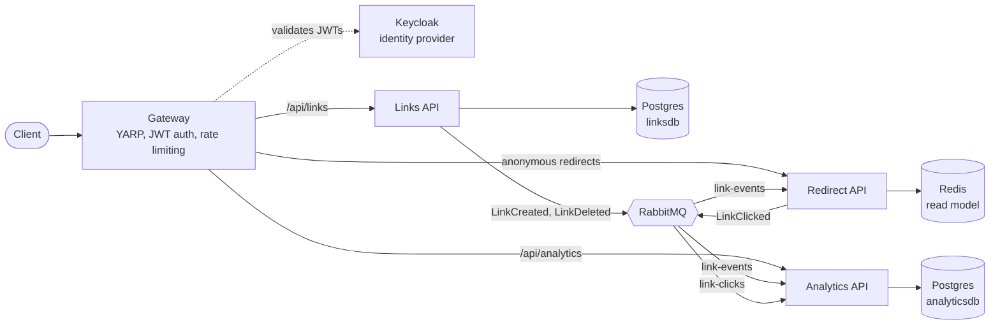

# URL Shortener

A microservices-based URL shortener built with **.NET 10** and **.NET Aspire**. It is a learning project for distributed-systems patterns: service discovery, event-driven messaging, the transactional outbox, event-fed read models, an API gateway and JWT authentication.

## Architecture



The three services never call each other. The Gateway is the only component that talks to them over HTTP; everything else flows through RabbitMQ. Links writes `LinkCreated` and `LinkDeleted` events to a transactional outbox and publishes them to the `link-events` exchange, which Redirect and Analytics consume. Redirect publishes `LinkClicked` events to the `link-clicks` exchange for Analytics.

| Service | Responsibility | Data store |
|---------|----------------|------------|
| **Links API** | Create, read and delete short links; publishes link events through a transactional outbox | Postgres `linksdb` |
| **Redirect API** | `GET /{code}` answers with a 302; resolves codes from an event-fed read model | Redis |
| **Analytics API** | Consumes `LinkClicked` events, serves per-day click stats, enforces link ownership | Postgres `analyticsdb` |
| **Gateway** | YARP entry point with Keycloak JWT validation and per-user rate limiting | none |

Supporting projects:

- **Shortener.AppHost** — Aspire orchestration for local development (Postgres, Redis, RabbitMQ, Keycloak and every service)
- **Shortener.ServiceDefaults** — shared OpenTelemetry, health checks, service discovery and HTTP resilience
- **Shortener.Contracts** — integration event records (`LinkCreated`, `LinkDeleted`, `LinkClicked`)

## Key Patterns Demonstrated

- **Database per service** — each service owns its data store; no service touches another's database.
- **Transactional outbox** (M3) — a link change is written in the same transaction as an outbox message, which a background dispatcher then publishes to RabbitMQ (at-least-once delivery).
- **Event-fed read model** (M3) — Redirect builds its own Redis read model from `LinkCreated` and `LinkDeleted` events, so it never calls Links and keeps redirecting while Links is down.
- **Idempotent consumers** (M2) — Analytics records each event ID in a `processed_events` table in the same transaction as the counter update, so a redelivered message is never counted twice.
- **Ownership projection** (M4) — Analytics maintains its own `link_owners` table from link events, so it can restrict stats to the link's owner without querying the Links database.
- **API gateway with YARP** (M4) — a single entry point with config-based routing and Aspire service-discovery destinations.
- **JWT authentication** (M4) — Keycloak issues tokens; the Gateway validates them and forwards the user's `sub` claim as `X-User-Id` (discarding any client-supplied value); the services enforce ownership.
- **Per-user rate limiting** (M4) — a fixed window of 10 link creations per minute per user.
- **Graceful degradation** — if Redirect cannot reach Redis it answers 503, never a misleading 404.

## Prerequisites

- [.NET 10 SDK](https://dotnet.microsoft.com/download/dotnet/10.0)
- [Docker Desktop](https://www.docker.com/products/docker-desktop/), which runs the Postgres, Redis, RabbitMQ and Keycloak containers
- Optional: the Aspire CLI, if you prefer `aspire run` to `dotnet run`

## Getting Started

**1. Clone the repository**

```bash
git clone https://github.com/sagarworlds/url-shortener-microservice.git
cd url-shortener-microservice
```

**2. Make sure Docker is running**

**3. Start the system**

```bash
aspire run
```

Or, without the Aspire CLI:

```bash
dotnet run --project Shortener.AppHost
```

The console prints the Aspire dashboard URL, where you can follow resource health, logs and distributed traces. The first run pulls the container images, so it can take a few minutes. Once everything is healthy:

- The Gateway, the public entry point, listens on `http://localhost:5295` by default (the dashboard shows the exact endpoint).
- Keycloak listens on `http://localhost:8080`.

**4. Run the tests**

```bash
dotnet test
```

## API Reference

All requests go through the Gateway; the examples below use `GATEWAY=http://localhost:5295`. Creating and deleting links, reading link details and reading analytics require a JWT, while redirects are anonymous. A link can only be read, deleted or inspected by the user who created it. Anyone else gets a `404`, so a link's existence is never revealed.

### Getting a token

Keycloak imports a ready-made realm on startup ([`shortener-realm.json`](Shortener.AppHost/KeycloakConfiguration/shortener-realm.json)): realm `shortener`, public client `shortener-api` with the password grant enabled, and two throwaway development users.

| Username | Password |
|----------|----------|
| `alice` | `alice` |
| `bob` | `bob` |

```bash
export GATEWAY=http://localhost:5295

export TOKEN=$(curl -s http://localhost:8080/realms/shortener/protocol/openid-connect/token \
  -d grant_type=password -d client_id=shortener-api \
  -d username=alice -d password=alice | jq -r .access_token)
```

The snippet uses [`jq`](https://jqlang.org) to extract the token from the JSON response.

### Links

| Method | Path | Auth | Description |
|--------|------|------|-------------|
| `POST` | `/api/links` | Required | Create a short link (10 per minute per user) |
| `GET` | `/api/links/{code}` | Required | Get a link's details (owner only) |
| `DELETE` | `/api/links/{code}` | Required | Delete a link (owner only) |

Request body for `POST /api/links`:

| Field | Required | Description |
|-------|----------|-------------|
| `url` | yes | Absolute `http` or `https` destination URL |
| `alias` | no | Custom short code of 3–32 letters and digits; omit it to get a random 7-character code |
| `expiresAt` | no | ISO 8601 timestamp after which the link stops resolving |

```bash
curl -X POST "$GATEWAY/api/links" \
  -H "Authorization: Bearer $TOKEN" \
  -H "Content-Type: application/json" \
  -d '{"url": "https://example.com", "alias": "demo"}'
```

A successful call returns `201 Created` with the link's `code`, `shortUrl`, `url` and `expiresAt`.

### Redirect

| Method | Path | Auth | Description |
|--------|------|------|-------------|
| `GET` | `/{code}` | None | `302 Found` redirect to the destination URL |

```bash
curl -i "$GATEWAY/demo"
```

### Analytics

| Method | Path | Auth | Description |
|--------|------|------|-------------|
| `GET` | `/api/analytics/{code}` | Required | Total and per-day click counts (owner only) |

```bash
curl "$GATEWAY/api/analytics/demo" -H "Authorization: Bearer $TOKEN"
```

```json
{
  "code": "demo",
  "totalClicks": 3,
  "dailyClicks": [
    { "date": "2026-09-28", "count": 3 }
  ]
}
```

Redirect and Analytics are fed by events over RabbitMQ, so they are eventually consistent: a new link starts resolving a moment after it is created, and clicks show up in analytics after a short delay.

### Error responses

Errors returned by the services use [RFC 9457 Problem Details](https://www.rfc-editor.org/rfc/rfc9457). The Gateway's own `401` and `429` responses have no body.

| Status | Meaning |
|--------|---------|
| 400 | Invalid request, such as a malformed URL or an invalid alias |
| 401 | Missing or invalid JWT |
| 404 | Unknown code, expired link, or a link owned by someone else |
| 409 | Alias already in use |
| 429 | Link-creation rate limit exceeded (10 per minute per user) |
| 503 | Redirect could not reach its Redis read model |

## Project Structure

```text
Shortener.slnx
Directory.Build.props               net10.0, nullable, warnings as errors, XML docs
Directory.Packages.props            central package management
Shortener.AppHost/                  Aspire orchestration
Shortener.ServiceDefaults/          shared OpenTelemetry, health checks, resilience
src/
  Shortener.Contracts/              integration event records
  Shortener.Gateway/                YARP, JWT auth, rate limiting
  Services/
    Links/Shortener.Links.Api/
    Redirect/Shortener.Redirect.Api/
    Analytics/Shortener.Analytics.Api/
tests/
  Shortener.Links.UnitTests/
  Shortener.Redirect.UnitTests/
  Shortener.Analytics.UnitTests/
  Shortener.IntegrationTests/       end-to-end via Aspire.Hosting.Testing
```

Each service follows the same four-folder layout:

| Folder | Responsibility | Depends on |
|--------|----------------|------------|
| `Domain/` | Entities and value objects | Nothing (no framework types) |
| `Application/` | Use-case handlers and the interfaces they need | Domain |
| `Infrastructure/` | EF Core, Redis and RabbitMQ implementations | Application interfaces |
| `Endpoints/` | Minimal API route mapping only | Application handlers |

## Tech Stack

| Component | Technology |
|-----------|------------|
| Runtime | .NET 10 |
| Orchestration | .NET Aspire 13.5 |
| API gateway | YARP 2.3 |
| Authentication | Keycloak, JWT bearer |
| Databases | PostgreSQL through EF Core |
| Cache and read model | Redis |
| Messaging | RabbitMQ |
| Observability | OpenTelemetry (traces, metrics, logs) |
| Resilience | Microsoft.Extensions.Http.Resilience (Polly) |
| Testing | xUnit, Aspire.Hosting.Testing |

## Milestones

| Milestone | Scope | Status |
|-----------|-------|--------|
| **M1** | Links + Redirect over HTTP, cache-aside with Redis | Done |
| **M2** | Analytics service, click events over RabbitMQ, idempotent consumers | Done |
| **M3** | Transactional outbox, event-fed Redis read model, Redirect decoupled from Links | Done |
| **M4** | YARP gateway, Keycloak auth, per-user rate limiting, link ownership | Done |
| **M5** | CI, container images, deployment | Not started |

See [docs/roadmap.md](docs/roadmap.md) for the detailed specs, "done when" criteria and experiment observations for each milestone.

## Design Decisions

- **302 Found, never 301.** Browsers cache a 301 permanently, which would hide clicks from analytics and make expiry and deletion unenforceable.
- **Unguessable short codes.** Generated codes are 7 Base62 characters from `RandomNumberGenerator`, backed by a unique index; a collision is retried up to 3 times. Custom aliases never retry: a collision is a `409`.
- **Only absolute `http` and `https` URLs** are accepted as destinations.
- **503, never a false 404.** If Redirect cannot reach its Redis read model it answers 503 instead of reporting the link as missing.
- **Clicks are best-effort, links are not.** Click events pass through a bounded in-memory buffer so a redirect never waits on the broker (an occasional click may be dropped), while link changes go through the transactional outbox and are never lost.
- **Nullable ownership.** `OwnerId` is optional, so links created without authentication skip ownership checks and existing data keeps working.
- **Database per service.** Analytics projects link ownership from events into its own `link_owners` table instead of querying the Links database.

## Testing

Unit tests cover domain logic, validation and the use-case handlers, including ownership enforcement. Integration tests use `Aspire.Hosting.Testing` to start the whole system with real Postgres, Redis, RabbitMQ and Keycloak containers, and cover link creation and redirects through the read model, click analytics, gateway authentication, ownership isolation between users and rate limiting.

```bash
# Unit tests only (no Docker needed)
dotnet test --filter "FullyQualifiedName!~IntegrationTests"

# Everything, including integration tests (Docker required)
dotnet test
```

## License

This project is for educational purposes.
